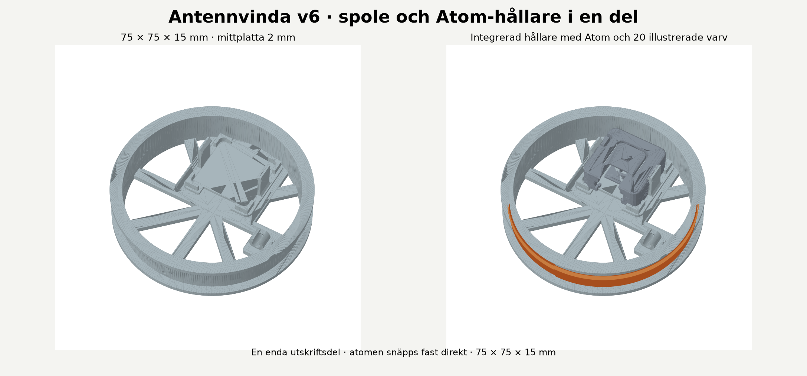

# ClockSync Evolved (v1.5.0)

**Designed specifically for the classic M5Stack Atom Lite (ESP32-PICO-D4).** ClockSync Evolved uses Wi-Fi time and a compact wire coil to sync nearby radio-controlled clocks. The default pins, RGB status LED, button controls and printable holder all target the Atom Lite. **DCF77 and Central European time are the defaults.**

This fork is maintained by [axelaberg91](https://github.com/axelaberg91/ClockSync-Evolved), based on [tanvach/clocksync](https://github.com/tanvach/clocksync) and [SASAKI Taroh's nisejjy](https://github.com/tarohs/nisejjy). It adds the **clocksync evolved** web interface and the printable coil build below.

For a standard dual-core ESP32 DevKit, see the [porting notes below](#other-esp32-boards) for the board settings, pins and physical mounting that may need to change.

Original code, documentation and assets added by **axelaberg91** use **CC BY-NC 4.0**. Commercial use of those contributions requires separate permission; axelaberg91 retains the right to sell their own work. **The inherited firmware's license remains unresolved.** See [licensing and scope](LICENSE.md) and the [hardware asset terms](hardware/LICENSE.md).

## Get started

1. **Build:** [download the print pack](hardware/print/clocksync-atom-lite-print-pack.zip?raw=true) and follow the short guide below.
2. **Install:** upload the firmware using **M5Stack 3.3.10 / M5Atom / Huge APP**. [Installation instructions](#firmware-setup).
3. **Connect Wi-Fi:** on an unconfigured device, join **clocksync**, password **clocksync**, and open `http://192.168.4.1`. Save your 2.4 GHz network, then rejoin it and open `http://clocksync.local` or the device IP.
4. **Use:** keep **DCF77 / GPIO32**, place your clock close to the coil and start its synchronization procedure. A short button press pauses/resumes; hold for 3 seconds to request time sync.

## Build the Atom Lite unit

**M5Stack Atom Lite · 20 turns of 0.5 mm enamelled copper wire · 330 ohm series resistor.**



### Download and print

**[Download the print pack](hardware/print/clocksync-atom-lite-print-pack.zip?raw=true)**, extract it and open `print/print-both.3mf` in your slicer. The pack contains both parts, editable CAD and these build instructions.

Individual files: [coil STL](hardware/coil/coil-75mm-integrated-holder.stl) · [connector clip STL](hardware/connector/dupont-housing-clip.stl) · [both parts as 3MF](hardware/print/print-both.3mf).

The coil former is **75 x 75 x 15 mm**. It includes the Atom snap holder and a side clip for the resistor. Print it as one part; no separate holder or glue is needed. The small connector clip is the second part.

### What you need

| Item | Amount |
| --- | --- |
| M5Stack Atom Lite and USB-C cable | 1 each |
| Enamelled copper wire, 0.5 mm | About 4.8 m including connection leads |
| Axial resistor, 330 ohm / 0.25 W | 1 |
| Jumper leads with complete single-pin Dupont female housings | 2 |
| Heat-shrink tubing | For the resistor and solder joints |

### Assemble and connect

1. Snap the Atom into the holder with USB-C and Grove facing inward.
2. Wind **20 turns** of 0.5 mm enamelled wire around the coil former and bring both ends inside through the shared opening.
3. Remove enamel from the ends, solder the circuit below and insulate the joints. Snap the resistor into the inside clip.
4. Fully insert the Dupont females on **G32 and GND**, then fit the guide over their rear ends. Leave **5V and G26** unused.

```text
G32 (GPIO32) ---- coil (20 turns) ---- 330 ohm ---- GND
```

Connect USB power, select **DCF77 / GPIO32**, and start the clock's synchronization procedure close to the coil.

## Firmware setup

In Arduino IDE, install **M5Stack by M5Stack official, version 3.3.10**, then select:

| Setting | Value |
| --- | --- |
| Tools → Board | M5Stack → **M5Atom** |
| Flash capacity | **4 MB** (Atom Lite) |
| Tools → Partition Scheme | **Huge APP (3MB No OTA/1MB SPIFFS)** |

No extra libraries are needed. Upload the sketch, then configure Wi-Fi through the setup portal. To compile Wi-Fi credentials instead, copy `secrets_example.h` to `secrets.h`; that file is excluded from Git.

DCF77 uses **`CET-1CEST,M3.5.0/2,M10.5.0/3`** by default. Transmission starts at the next whole minute after a confirmed NTP reply. A new reply is required after every boot, and transmission stops after 23 hours without one.

The web interface's **Wi-Fi settings** can save a new network for the next startup or forget the saved network. Saving or forgetting does not disconnect the current connection; restart to apply it.

<details>
<summary>Installation, Wi-Fi setup and other time zones</summary>

1. **Wi-Fi setup**:
    * With no saved network and no `secrets.h`, the device immediately starts the AP **clocksync**, password **clocksync**. Connect to it and open `http://192.168.4.1` (a captive portal may also open automatically).
    * Enter the target 2.4 GHz SSID and PSK. The previous stored network is kept until the new connection succeeds. A successful network is saved as one NVS record and survives reboot.
    * To prepare a network change in advance, open **Wi-Fi settings** on the normal status page. Enter the target SSID and password, then choose **Save for next startup**. The current network remains connected, including when it needs to reconnect before restart. New credentials are saved without testing them; they are first used after a restart. The existing 10-minute AP fallback applies if the new connection fails.
    * **Forget Wi-Fi** asks for confirmation, clears the saved network, and makes the next startup open **clocksync** immediately. It does not restart or disconnect the device. This explicit reset suppresses compiled `secrets.h` credentials and stays in effect across restarts until a new network is saved through the setup portal or normal Wi-Fi settings.
    * The setup AP closes about 15 seconds after a confirmed connection. Rejoin your normal Wi-Fi and open `http://clocksync.local` or the IP shown on the setup page/serial monitor.
    * After **10 minutes of continuous Wi-Fi disconnection**, setup AP mode starts automatically while station reconnect attempts continue every 60 seconds. This also recovers from a changed SSID/password. A short disconnection that recovers resets the 10-minute timer.
    * Boot priority: **explicit Wi-Fi reset**, saved configuration, optional compiled `secrets.h`, then setup AP. To compile credentials, copy `secrets_example.h` to `secrets.h` and fill in the two defines. The secrets file is ignored by Git and is optional. Forgetting Wi-Fi does not remove credentials embedded in the firmware; it prevents their use at startup.
    * Wi-Fi passwords are never returned by the APIs. Network names are shown so you can distinguish the current and next-startup settings. The transmit guard is independent: setup AP mode does not validate time or reset the 23-hour limit.
2.  **Timezone (Critical)**:
    *   Open `clocksync.ino`.
    *   Find the line `#define TZ "..."`.
    *   Change the string to match your station. ESP32 requires a POSIX TZ string (not Olson names like `America/Los_Angeles`).
    *   **WWVB (USA)**: Set TZ to your US timezone. WWVB frame time is always UTC (via `gmtime()`), so there is no double-offset risk — TZ only affects the DST status bits.

        | Region | POSIX TZ string |
        | :--- | :--- |
        | Pacific (LA, SF, Seattle) | `PST8PDT,M3.2.0,M11.1.0` |
        | Mountain (Denver, Phoenix†) | `MST7MDT,M3.2.0,M11.1.0` |
        | Central (Chicago, Dallas) | `CST6CDT,M3.2.0,M11.1.0` |
        | Eastern (NYC, Miami) | `EST5EDT,M3.2.0,M11.1.0` |
        | Hawaii | `HST10` |

        †Arizona (no DST): use `MST7` instead.

    *   **Other stations**: These transmit local time directly, so TZ must match the station's native timezone:

        | Station | Region | POSIX TZ string |
        | :--- | :--- | :--- |
        | JJY | Japan | `JST-9` |
        | DCF77 | Germany / Central Europe | `CET-1CEST,M3.5.0/2,M10.5.0/3` |
        | MSF | United Kingdom | `GMT0BST,M3.5.0/1,M10.5.0` |
        | BSF | Taiwan | `CST-8` |
        | BPC | China | `CST-8` |

    *   **Lookup**: Find any POSIX TZ string by city name in [this table](https://github.com/nayarsystems/posix_tz_db/blob/master/zones.csv). On Mac/Linux: `tail -1 /etc/localtime`
3. **Dependencies & Upload**:
    * Target: **M5Stack by M5Stack official 3.3.10**, board **M5Atom** (the classic Atom Lite, not AtomS3).
    * Add `https://static-cdn.m5stack.com/resource/arduino/package_m5stack_index.json` under Additional Board Manager URLs. Install version **3.3.10** and select **Tools → Board → M5Stack → M5Atom**.
    * Use **Huge APP (3MB No OTA/1MB SPIFFS)** with the Atom Lite's **4 MB** flash. No external Arduino libraries are required.
    * From the directory containing the project:

        ```bash
        arduino-cli core update-index --additional-urls https://static-cdn.m5stack.com/resource/arduino/package_m5stack_index.json
        arduino-cli core install m5stack:esp32@3.3.10 --additional-urls https://static-cdn.m5stack.com/resource/arduino/package_m5stack_index.json
        arduino-cli compile --fqbn m5stack:esp32:m5stack_atom:PartitionScheme=huge_app clocksync
        arduino-cli upload -p COM_PORT --fqbn m5stack:esp32:m5stack_atom:PartitionScheme=huge_app clocksync
        ```

    * The older Espressif 2.0.17 build is a historical compatibility result. The current target and configuration instructions above use M5Stack 3.3.10.

</details>

<details>
<summary>Button, status LED, saved settings and NTP timing</summary>

After a confirmed NTP sync, transmission starts at the next whole minute so the first frame is complete. It can take another minute for a receiver to decode that frame; many clocks require several frames.

- **Status LED**: Green = normal transmission. Yellow = waiting for time/alignment or a confirmed sync is more than 3 h 15 min old. Red = Wi-Fi disconnected while time may still be valid. Blinking red = the 23-hour guard or radio error has stopped transmission. User pause and the LED-off setting override all colors.
- **Button**: Short press pauses/resumes. Hold 3 seconds to request NTP sync.
- **Web UI**: Visit `http://clocksync.local` (or the device IP). Pause/resume, request sync, change radio settings, and prepare Wi-Fi changes for the next startup. Status polls every 2 seconds while the tab is visible. Wi-Fi settings load when their section is opened; they are not polled in the background. The clock updates locally at each displayed second boundary.
- **23-hour limit**: Counts from the last confirmed SNTP reply using monotonic time. Wi-Fi reconnection, manual time changes and pressing resume cannot extend it. After expiry, the transmitter stops and the LED blinks red. A new confirmed sync restores eligibility; a user pause stays paused.
- **Saved settings**: Transmission request, station, GPIO, drive, LED, DST override, NTP enable and provisioned Wi-Fi survive reboot. The `r` command resets radio settings; it leaves provisioned Wi-Fi in its separate namespace. Time trust never survives reboot.
- **NTP interval**: A refresh is requested every 3 hours. Yellow warns after that interval plus 15 minutes; the strict stop remains at 23 hours.

</details>

<details>
<summary>Commands, HTTP endpoints and supported stations</summary>

Control the device via Serial Monitor (115200 baud) or via HTTP (`http://clocksync.local/cmd?c=<command>`).

| Command | Description | Example |
| :--- | :--- | :--- |
| **Stations** | | |
| `sj` | Set station to **JJY (40 kHz)** (Fukushima) | `sj` |
| `sk` | Set station to **JJY (60 kHz)** (Fukuoka) | `sk` |
| `sw` | Set station to **WWVB (60 kHz)** (USA) | `sw` |
| `sd` | Set station to **DCF77 (77.5 kHz)** (Germany) | `sd` |
| `sm` | Set station to **MSF (60 kHz)** (UK) | `sm` |
| `st` | Set station to **BSF (77.5 kHz)** (Taiwan) | `st` |
| `sc` | Set station to **BPC (68.5 kHz)** (China) | `sc` |
| **Control** | | |
| `e1` / `e0` | **Enable / Disable Transmission** (Carrier & Logic) | `e1` |
| `pNN` | Set Radio Output Pin (GPIO `NN`) | `p25` |
| `g0` - `g3` | Set Drive Strength (0=Weakest, 3=Strongest) | `g2` |
| **Settings** | | |
| `y1` / `y0` | NTP Sync On / Off (23-hour guard still applies) | `y1` |
| `u` | Request a fresh NTP sync and enable NTP | `u` |
| `l1` / `l0` | LED On / Off | `l1` |
| `x0` - `x2` | DCF/MSF DST Override (0=Std, 1=DST, 2=Auto) | `x2` |
| **Manual Time** | | |
| `dYYMMDD` | Set Date; invalidates time trust until a new NTP reply | `d231225` |
| `tHHmmSS` | Set Time; invalidates time trust until a new NTP reply | `t123000` |
| **Debug** | | |
| `h` | Show Help | `h` |
| `f` | Frequency Self-Test (Requires jumper `PIN_RADIO` -> `PIN_MEAS`) | `f` |
| `r` | Restore default settings and request NTP sync | `r` |

### HTTP endpoints

- `GET /`: web interface stored in flash, with no external assets.
- `GET /api/status`: JSON status, including requested/actual transmission, NTP age and holdover remaining.
- `GET /status.txt`: diagnostic text (including actual configured carrier frequency).
- `POST /cmd`: form field `c` with a command above. Legacy `GET /cmd?c=...` is also accepted.
- `POST /api/settings`: form fields `station`, `pin`, `drive`, `led`, `dst`. Invalid values are rejected together.
- `GET /api/wifi`: setup status and CSRF token, available only through the setup AP interface; never returns the PSK.
- `POST /api/wifi`: form fields `ssid`, `psk`, `token` from the setup AP. Starts a nonblocking station connection and saves only after success.

## Supported Stations

| Station | Freq (kHz) | Location | Notes |
| :--- | :--- | :--- | :--- |
| **JJY** | 40 / 60 | Japan | Default is end-Low symbol shape. |
| **WWVB** | 60 | USA | UTC framing; DST bits derived from TZ setting. |
| **DCF77** | 77.5 | Germany | "Start-Low" encoding. |
| **MSF** | 60 | UK | Includes parity and DST bits. |
| **BSF** | 77.5 | Taiwan | Quaternary encoding (uncertified). |
| **BPC** | 68.5 | China | Quaternary encoding (uncertified). |

</details>

<details>
<summary>Troubleshooting</summary>

*   **Clock isn't syncing**:
    *   **Proximity**: Move the clock *closer* to the antenna. It usually needs to be touching.
    *   **Interference**: LED power supplies and monitors cause noise. Move away from them.
    *   **Volume**: Increase "Volume" (Drive Strength) to `g3` using the Serial/Web command.
    *   **Antenna**: Ensure your antenna wire isn't broken and the resistor is secure.
*   **Clock shows wrong time**:
    *   **Timezone**: Check the `#define TZ` line in `clocksync.ino`. For WWVB, use a US POSIX timezone (see setup step 2).
    *   **DST off by 1 hour (WWVB)**: If TZ is set to `"UTC0"`, DST bits will always be 0 and your clock won't spring forward. Set TZ to your US timezone.
* **Compilation Error**: Confirm that **M5Stack 3.3.10 / M5Atom** is selected and all project headers are in the sketch folder. External M5Atom/FastLED libraries are not used by this version.

</details>

## Other ESP32 boards

<details>
<summary>Porting to a standard ESP32 DevKit</summary>

The **classic M5Stack Atom Lite** is the development and build target. Other boards require adaptation to their actual hardware. A standard DevKit configuration has not been verified by this project.

### Atom Lite versus a standard ESP32 DevKit

Here, "standard ESP32" means a classic, dual-core ESP32 DevKit/WROOM board. ESP32-S3, C3 and other chip families need their own review.

| Item | Atom Lite | Standard ESP32 DevKit |
| :--- | :--- | :--- |
| Board selection | **M5Atom** in M5Stack's package | Usually **ESP32 Dev Module** in Espressif's package; match the actual board |
| Processor | ESP32-PICO-D4, dual core, up to 240 MHz | Classic ESP32/WROOM uses the same processor architecture and LEDC peripheral |
| DCF77 and NTP logic | This project's normal implementation | The protocol, 23-hour guard and 77,500 Hz carrier request need no board-specific changes |
| Antenna output | GPIO32 on the Grove connector's white wire, through the coil and series resistor to GND | GPIO32 can be used if it is exposed and free; wire to the labeled GPIO, not a connector position |
| Status LED | Addressable RGB LED on GPIO27 via the core RGB driver (`PIN_RGB_LED`) | Set `PIN_RGB_LED` to a suitable addressable LED pin, or `-1`. For a simple LED, set `PIN_LED` and check its polarity |
| Button | Active-low button on GPIO39 (`PIN_BUTTON`), external pull-up on Atom Lite, 10 ms software debounce | Set `PIN_BUTTON` to the connected button pin or `-1` to disable it. GPIO34–39 require an external pull-up. BOOT is not automatically the application control button |
| Flash | 4 MB; use a partition scheme for 4 MB flash | Match the actual flash size, flash mode and partition layout; PSRAM is not required |
| Hardware initialization | Core GPIO/RGB functions; no M5Atom library | Adjust the LED/button pin definitions. Changing the board menu does not add missing physical hardware |

### What to change

1. **Board profile and flash layout:** select the actual board in Arduino IDE, using the appropriate ESP32 board package. Match its flash size and partition layout. The M5Atom profile and the printed Atom holder are specific to the Atom Lite.
2. **Antenna pin and wiring:** review `PIN_RADIO` in `clocksync.ino`. GPIO32 is the default; keep it only if the board exposes it and it is free. Connect the coil and series resistor to the labeled GPIO and GND. The Atom's Grove wire colours and connector positions do not describe a DevKit's headers.
3. **Status LED:** set `PIN_RGB_LED` to the pin of a compatible addressable RGB LED, or `-1` if none is fitted. For a simple LED, set `PIN_LED` instead and disable `PIN_RGB_LED`. The current `indicator()` output is active high; an active-low LED requires that output logic to be inverted. A simple LED cannot display the RGB status colours.
4. **Button:** set `PIN_BUTTON` to the connected active-low button pin, or `-1` to use only the web controls. GPIO34-39 need an external pull-up. Other button inputs use the internal pull-up in the current code. The Atom's GPIO39 button and the DevKit's BOOT button are separate hardware arrangements.
5. **Physical mounting:** the integrated holder fits the Atom Lite enclosure. A DevKit needs a suitable mount or a revised holder with clearances for its board, USB connector and pin headers.

For example, a classic dual-core DevKit with GPIO32 available and no connected status LED or button can start with these definitions in `clocksync.ino`:

```cpp
#define PIN_RADIO 32
#define PIN_LED -1
#define PIN_RGB_LED -1
#define PIN_BUTTON -1
```

This example disables the physical status indicators and button; the web controls remain available. It is a porting starting point, not a verified DevKit build.

The current radio-pin allowlist in `safePin()` and the web selector are **19, 21, 22, 23, 25, 26, 32 and 33**. If a port needs a different radio pin, update both `safePin()` in `clocksync.ino` and the antenna-pin selector in `web_ui.h` after checking that pin against the board's hardware. Optional frequency measurement uses `PIN_MEAS` (GPIO33 by default); review it if using the measurement jumper.

If the board already has saved radio settings, check the antenna pin in the web interface: the saved pin takes precedence over the compiled default.

The radio task is pinned to **core 1**. These notes apply to a classic **dual-core** ESP32; single-core devices need a separate review of task placement, GPIOs and peripherals. ESP32-S3 and other families also need their own board-specific review. Confirm the carrier frequency and modulation timing on the adapted hardware.

The **M5Stack board package** supplies the framework, compiler and board profile. This fork no longer needs the separate M5Atom or FastLED libraries for the Atom Lite's one status pixel and button. The web interface does not display a board-specific label.

A simple onboard LED can show on/off/blinking, but needs to be replaced or supplemented with an addressable RGB pixel to display the green/yellow/red status colors.

The standard DevKit hardware configuration has not been verified by this project. See [Atom Lite's official pin map](https://docs.m5stack.com/en/core/Atom-Lite) for the Atom connections.

</details>

## More details

<details>
<summary>Features, release notes and source history</summary>

### Features

- **Multi-Station Support**: Emulates JJY (Japan), WWVB (USA), DCF77 (Germany), MSF (UK), BSF (Taiwan), and BPC (China).
- **Web Control**: Simple web interface for status monitoring and configuration.
- **Home Assistant Integration**: REST API for scheduling transmission (e.g., run only at night).
- **Signal Timing**: Hardware LEDC generates the carrier. A dedicated radio task applies modulation from absolute wall-clock time, independently of web requests.

### Source history

- [upstream-baseline](https://github.com/axelaberg91/ClockSync-Evolved/tree/upstream-baseline) preserves the original fork snapshot from `tanvach/clocksync`, commit `63d92cae27f5085cbd8474151474e6ea8660a867` (v1.3.1), before the changes credited to axelaberg91.
- [v1.5.0](https://github.com/axelaberg91/ClockSync-Evolved/tree/v1.5.0) marks the current clocksync evolved version. The default `master` branch contains the current fork code, with the original Git history retained.
- Local Wi-Fi credentials (`secrets.h` or `secret.h`) and compiled firmware files are excluded from version control. Use `secrets_example.h` as a template or configure Wi-Fi through the setup portal.

### What's New in v1.5.0

- The status interface, setup portal and device messages use English. The local clock keeps Central European time and now retains fractional seconds when refreshing its display.
- The normal web interface has **Wi-Fi settings**. **Save for next startup** stores a new SSID/password without changing the current connection or its reconnect settings. Credentials are first tried after restarting the device.
- **Forget Wi-Fi** clears the saved network after confirmation and makes the next startup open the setup AP. The reset also overrides compiled `secrets.h` credentials until a new network is saved; the current connection stays active until restart.
- Current and next-startup networks are shown separately. Saved passwords are never returned to the browser. The healthy-connection footer text has been removed.
- Status LEDs use distinct green, yellow and red channel values at low brightness.

### What's New in v1.4.0

- DCF77 uses a 77,500 Hz carrier request with 8-bit LEDC PWM. Technical status shows the actual configured frequency, which may differ slightly because of the hardware divider.
- The DCF77 frame carries the following minute, including date rollover, Sunday = 7, DST flags and the A1 change announcement.
- Transmission requires a confirmed SNTP reply after every boot. It stops after 23 hours without a new reply; Wi-Fi connectivity alone does not reset this limit.
- Wi-Fi reconnect attempts continue every 60 seconds. Network operations and HTTP run separately from the radio task.
- Short button press pauses/resumes the requested transmission state. Hold for 3 seconds to request time sync; release does not also toggle transmission.
- Status LED: green for normal transmission, yellow while waiting for NTP/frame alignment or after 3 h 15 min without a confirmed sync, red for disconnected Wi-Fi, blinking red for expired time or a radio error. A user pause or disabling the LED turns it off.
- A compact Swedish web interface shows transmitter status, connection, last confirmed sync, LED state and time remaining, with mobile layout and advanced settings.
- Built-in Wi-Fi provisioning: AP SSID/password `clocksync`, immediate when unconfigured or after 10 minutes of continuous Wi-Fi loss. A successful setup is stored in NVS and overrides compiled credentials.
- Target build: M5Stack board package 3.3.10, board M5Atom. RGB and debounced button control use the ESP32 core directly; no external M5Atom/FastLED libraries are required.

### What's New in v1.3.1

- **Prevent NVS flash wear**: Added `WiFi.persistent(false)` to stop the WiFi library from writing credentials to flash on every connect/disconnect cycle.
- **Buzzer default off**: Buzzer now defaults to off on fresh install and reset.
- **Tristate radio pin when TX off**: Radio output pin is now set to high-impedance (INPUT) when TX is disabled or when switching pins, instead of being driven LOW.

### What's New in v1.3

- **Fix WWVB DST bits**: Changed default TZ from `"UTC0"` to `"PST8PDT,M3.2.0,M11.1.0"`. With `"UTC0"`, DST status bits were always 0, causing clocks to stay on standard time after DST started. Updated documentation and status display to clarify that WWVB DST bits are derived from the TZ setting.
- **Remove dead `q` command**: Removed unused `q0/q1/q2` WWVB pending override command and related dead code (`wwvbPendingOverride`, `getWWVBPendFlag`).

</details>

<details>
<summary>CAD sources and hardware checks</summary>

- [Coil OpenSCAD](hardware/coil/coil-75mm-integrated-holder.scad) · [connector clip OpenSCAD](hardware/connector/dupont-housing-clip.scad).
- [Coil geometry report](hardware/coil/geometry-checks.json) · [connector geometry report](hardware/connector/geometry-checks.json).
- The coil and clip are each one closed connected mesh. STL geometry matches the delivered designs. The combined plate was sliced in PrusaSlicer 2.9.6 without support or stability warnings.
- CAD has some fixed coordinates: recheck fit and slicing after editing dimensions.

</details>

<details>
<summary>Firmware verification and limits</summary>

The earlier v1.4.0 credential variants were compiled successfully with **M5Stack 3.3.10 / M5Atom / Huge APP** on 2026-10-17: with `secrets.h` and from a separate source copy without it. Compiler dependencies confirm that the latter does not include `secrets.h`. Those builds used approximately **1.08 MB program storage and 53,520 bytes of static RAM**. The package produced pin-macro redefinition warnings from its own Atom variant header, with no compilation errors. No vendor files were modified to suppress those warnings. These figures do not measure the current v1.5.0 revision.

Host-side tests in `tests/logic_test.cpp` cover 13 DCF77 calendar/DST cases, all three parity fields, the exact 23-hour boundary, button gestures/debounce and RGB status priority. They all pass. They use fixed local-time fixtures and do not validate ESP32 libc timezone behavior or electrical output. The Wi-Fi form was checked in a browser with simulated responses, including successful submission and a 390-pixel layout without horizontal overflow.

A physical Atom Lite, antenna, receiver and frequency/timing measurements are still required to verify the emitted signal and operation under Wi-Fi/web load. This fork does not generate DCF77 leap-second announcements or leap-second frames. Other station encoders are retained from upstream and have not received the same review as DCF77.

The AP start/10-minute fallback, real Wi-Fi authentication, NVS persistence across power loss and AP shutdown must also be checked on a physical Atom. A successful build and simulated web responses do not verify those radio/network behaviors.

The v1.5.0 English interface, deferred Wi-Fi changes and explicit Wi-Fi reset have not been rebuilt or exercised on hardware. In particular, confirm that the old network stays active after saving, that the new network is selected after restart, and that forgetting Wi-Fi opens the setup AP even when the firmware contains compiled credentials.

</details>

For protocol and signal-timing details, see [HOW_IT_WORKS.md](HOW_IT_WORKS.md).

## Credits

- **Original Author**: SASAKI Taroh (tarohs) - [nisejjy](https://github.com/tarohs/nisejjy)
- **Upstream clocksync**: Tanvach - [tanvach/clocksync](https://github.com/tanvach/clocksync)
- **Fork improvements (v1.4.0-v1.5.0)**: [axelaberg91](https://github.com/axelaberg91/ClockSync-Evolved) - DCF77 encoding and timing fixes; confirmed-NTP and 23-hour transmission safeguards; Atom Lite button and RGB status handling; Wi-Fi setup, fallback and next-startup configuration; and the English **clocksync evolved** web interface.
- **Reference**: [txtempus](https://github.com/hzeller/txtempus) by Henner Zeller (used for WWVB frame verification).
- **Printable hardware**: developed for Axel's build with Codex assistance, starting from Axel's original coil-former concept.

<details>
<summary>Dimensional references and license status</summary>

Hardware references: [M5Stack Atom Lite enclosure](https://github.com/m5stack/M5_Hardware/tree/master/Products/C008_Atom-Lite/Structures), [Pololu connector housing](https://www.pololu.com/product/1900) and [Grove connector drawing](https://statics3.seeedstudio.com/images/opl/datasheet/3470130P1.pdf). Reference meshes are not included.

Original fork contributions and printable hardware by axelaberg91 are licensed under **CC BY-NC 4.0**, with attribution and non-commercial use required. The rights holder may still sell their own work or grant separate commercial permission. The inherited firmware's license remains unresolved; upstream code and third-party references are not relicensed. See [LICENSE.md](LICENSE.md) and [hardware/LICENSE.md](hardware/LICENSE.md).

</details>
