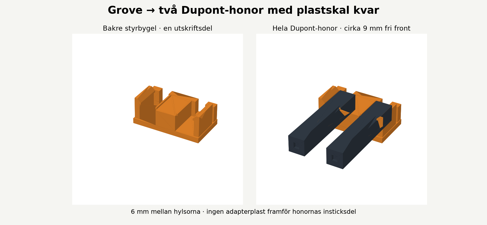

# Build the Atom Lite coil unit

Build the same unit as Axel: a printed Atom Lite holder and coil former, 20 turns of 0.5 mm enamelled copper wire, and a 330 ohm series resistor. Axel has printed the parts, checked their fit and tested the assembled unit. Software installation and operation belong to the [main firmware guide](../README.md).

## Bill of materials

| Quantity | Item | Specification |
| --- | --- | --- |
| 1 | M5Stack Atom Lite | Original 24 x 24 x 9.5 mm model; other Atom variants need a fit check |
| 1 | Printed coil former | Supplied integrated-holder model, 75 x 75 x 15 mm |
| 1 | Printed connector clip | Supplied rear guide, 10.64 x 5.85 x 4.10 mm |
| About 4.8 m | Enamelled copper wire | 0.5 mm nominal diameter, including allowance for two 20 cm leads; check actual diameter including enamel |
| 1 | Axial resistor | 330 ohm, 0.25 W, in series with the coil |
| 2 | Jumper leads | Complete single-pin Dupont female housings; nominal housing 2.54 x 2.54 x 14 mm |
| As needed | Heat-shrink tubing | Insulate solder joints; sleeved resistor target diameter 3.0-3.4 mm |
| 1 | USB-C power cable and supply | Compatible with the Atom Lite |

Tools: slicer and 3D printer, soldering tools, wire cutters, enamel removal tools and a multimeter. No glue is needed between the Atom holder and the coil former: they print as one part. The Atom is retained mechanically by the snap arms.

## 1. Print and check the fit

The starting setup is a **Prusa CORE One, PLA, 0.4 mm nozzle**. Other printers and materials may need tolerance adjustments.

For a shared plate, use **0.12 mm layers, 4 perimeters, 20% gyroid, no supports**, with the supplied flat bottoms on the bed and scale at **100%**. Select temperature and bed settings from your own PLA profile. The coil alone was also sliced at 0.20 mm layers. The small clip can use 100% rectilinear infill when printed separately.

Let both parts cool. Remove any elephant foot or loose strands from the fit surfaces. Check the Atom fit before winding or soldering. The USB-C and Grove ports must face the large open area toward the centre of the former; the button stays accessible above. Press the Atom in until the snap arms engage. To remove it, gently spread the arms only as far as necessary. Do not force a tight fit.

The complete unit's printed envelope is 75 x 75 x 15 mm. USB cables, connector housings, wire routing and bend radii are additional space requirements.

## 2. Wind the coil

The winding core is 69 mm in diameter with an 8.8 mm straight winding height. Use **20 turns**, the count in Axel's working build. Arrange them as 15 turns in the first layer and 5 in the second.

1. Leave about 20 cm for the first connection lead and route it through the inward-facing 1.8 mm exit.
2. Wind closely around the outside of the circular core between the flanges. Avoid kinks or damaged enamel.
3. After 15 turns, start a second layer and reverse the axial travel while continuing the same rotational direction around the coil.
4. After 5 more turns, leave about 20 cm for the second lead and feed it through the same exit to the interior. Avoid pinching or scraping the enamel.

| Turns | Layer arrangement | Approximate wire including both leads |
| --- | --- | --- |
| 10 | 10 | 2.6 m |
| 20 | 15 + 5 | 4.8 m |
| 30 | 15 + 15 | 7.0 m |

These are geometric estimates for 0.5 mm wire. Actual insulation diameter, winding spacing and lead routing affect capacity and length. This is an untuned loop; no capacitor or ferrite core is specified for this build.

## 3. Wire the Grove outer pins

Disconnect USB power while assembling. On the original Atom Lite, **GPIO32 is available on the Grove connector below USB-C**. Use the labels or the [official pin map](https://docs.m5stack.com/en/core/Atom-Lite); do not infer pin assignment from left/right in a photograph. The inherited main README's statement about GPIO32 being on the bottom header does not apply to this build.

```text
Grove G32 (GPIO32) ---- coil ---- 330 ohm resistor ---- Grove GND

Grove middle pins: 5V and G26 remain unconnected.
```

Use 330 ohm to reproduce the tested build. The upstream design allows 220-330 ohm; the resistor may be on either side of the coil as long as it is in series. Do not connect the coil directly between G32 and GND without it.

Remove the enamel only from the wire ends that will be soldered, tin them, and solder the coil and resistor to the two female jumper leads. Insulate all exposed joints. Shrink the sleeve over the resistor and let it cool before placing it in the side clip. The pocket is 3.4 mm in diameter, with a 2.5 mm opening and 1.2 mm wall thickness; fit depends on the actual resistor and sleeve. Keep resistor legs and wires beside the open connector corridor.

Before connecting power, use a multimeter to confirm the series path and check for unintended connections to the unused Grove pins. The resistance across the finished leads should include the 330 ohm resistor plus the winding and lead resistance.

## 4. Fit the complete Dupont females and rear clip



This design retains the original plastic housings. It has **no front collar or inserted dummy plug**. The two middle Grove positions remain unused. The clip's 6 mm centre spacing guides the outer positions.

The builder has confirmed that their two complete female housings can fully enter the Grove port without the printed clip. Other jumper housings may differ: establish that fit before using the clip.

1. Seat both complete female housings fully on GND and G32, without the clip, while power is disconnected.
2. Fit the clip over their rear portions. Hook the inner upper edge under the fixed lip, then gently press the outer edge past the spring lip. The open rear slots accept the existing wires.
3. Keep both females at their individual full insertion depths. Reposition the clip if it pushes either connector back or forces unequal-length housings to align at their rear ends.
4. Check that both contacts still seat completely and grip electrically. Disconnect by holding the housings, not pulling their wires.

The clip leaves at least 8.9 mm of the housing front free for nominal 14 +/- 0.25 mm housings. Full insertion does not prove adequate metal contact pressure; check both seating and continuity. The printed guide does not convert unsuitable contacts into a qualified Grove connector.

## 5. Configure and test

Install and configure the finalized firmware using the main repository guide. This build requires the radio output to be **GPIO32** and the station to be **DCF77, 77.5 kHz**. Use that firmware's documented DCF77 time-zone handling; software settings may change while firmware work is being finalized.

Start with the receiving clock close to the coil, move or rotate it to find a useful position, and run the clock's manual synchronization procedure. Keep a record of turn count, resistor, receiver model, orientation and firmware commit. Axel has confirmed successful operation of this build. A receiver model, measured range and exact firmware commit have not been recorded in this hardware guide.

If it does not synchronize, first check enamel removal, continuity through the resistor and coil, connector seating, station selection and output pin. Then try receiver position and orientation. See the [validation record](VALIDATION.md) for the tested configuration.
